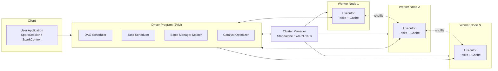
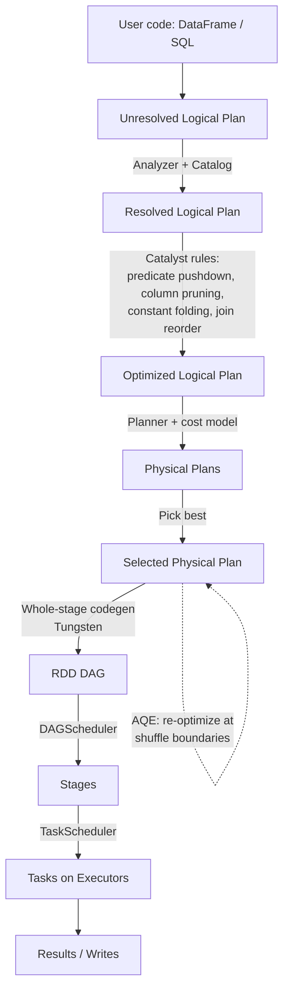
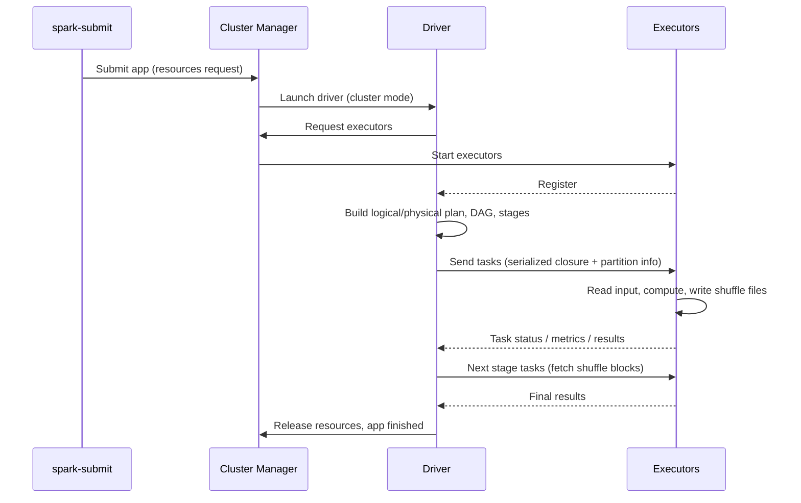
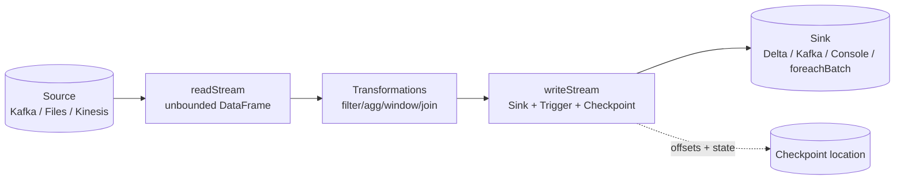
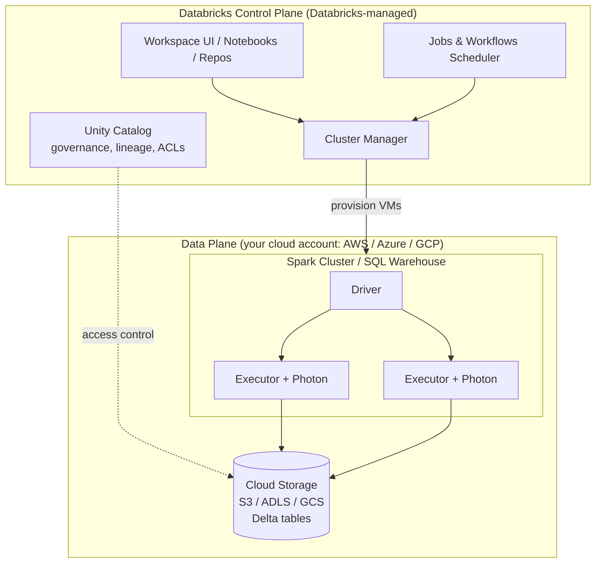
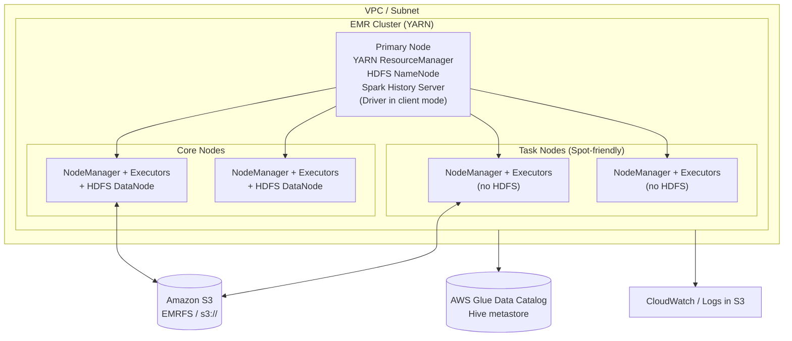
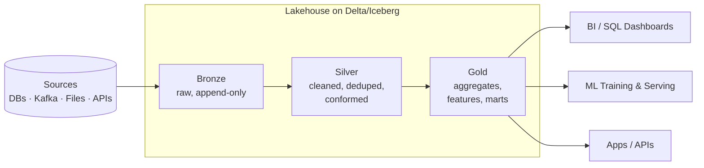

# Apache Spark – Reference Card & Cheat Sheet

> Covers: basics · concepts · architecture · execution model · Spark SQL/DataFrames · Streaming · MLlib · tuning · Databricks · AWS EMR · Scala/Java/PySpark snippets · use cases · pros & cons
> Version context: Spark 3.5 / 4.x (APIs largely identical; differences noted where relevant)

---

## Table of Contents

1. [What is Spark?](#1-what-is-spark)
2. [Core Concepts](#2-core-concepts)
3. [Architecture](#3-architecture)
4. [Job Execution Flow](#4-job-execution-flow)
5. [Transformations, Actions, Shuffles](#5-transformations-actions-shuffles)
6. [Setup & SparkSession](#6-setup--sparksession)
7. [PySpark Cheat Sheet (DataFrame API)](#7-pyspark-cheat-sheet-dataframe-api)
8. [Spark SQL](#8-spark-sql)
9. [Java API Snippets](#9-java-api-snippets)
10. [RDD API](#10-rdd-api)
11. [Structured Streaming](#11-structured-streaming)
12. [MLlib](#12-mllib)
13. [Data Sources & Formats](#13-data-sources--formats)
14. [Performance Tuning](#14-performance-tuning)
15. [Cluster Managers & Deployment](#15-cluster-managers--deployment)
16. [Databricks](#16-databricks)
17. [AWS EMR](#17-aws-emr)
18. [Platform Comparison](#18-platform-comparison)
19. [Typical Use Cases](#19-typical-use-cases)
20. [Pros & Cons](#20-pros--cons)
21. [Testing & Debugging](#21-testing--debugging)
22. [Common Pitfalls & Best Practices](#22-common-pitfalls--best-practices)
23. [Quick Reference Tables](#23-quick-reference-tables)

---

## 1. What is Spark?

**Apache Spark** is an open-source, distributed, in-memory-optimized **unified analytics engine** for large-scale data processing. It provides APIs in **Scala, Java, Python, R, and SQL**.

| Property | Description |
|---|---|
| Origin | UC Berkeley AMPLab (2009), Apache top-level project (2014) |
| Written in | Scala (runs on the JVM) |
| Paradigm | Distributed, lazy, DAG-based computation |
| Speed | Up to 100x faster than Hadoop MapReduce in memory, ~10x on disk |
| Fault tolerance | Lineage-based recomputation (RDD lineage), checkpointing |
| Workloads | Batch, SQL, streaming, ML, graph |

### The Spark Stack

```
┌──────────────────────────────────────────────────────────────┐
│  Spark SQL / DataFrames │ Structured │  MLlib   │  GraphX    │
│  & Datasets             │ Streaming  │ (ML)     │ (graphs)   │
├──────────────────────────────────────────────────────────────┤
│                      Spark Core (RDD API)                    │
│   scheduling · memory mgmt · fault recovery · I/O · shuffle  │
├──────────────────────────────────────────────────────────────┤
│  Standalone │  YARN  │  Kubernetes  │  Mesos (deprecated)    │
└──────────────────────────────────────────────────────────────┘
        Storage: HDFS · S3 · ADLS · GCS · Cassandra · JDBC · Kafka · Delta/Iceberg/Hudi
```

### Spark vs. Hadoop MapReduce (short)

| Aspect | MapReduce | Spark |
|---|---|---|
| Intermediate data | Written to disk | In memory (spills to disk if needed) |
| Model | Map → Reduce only | Arbitrary DAG of operators |
| APIs | Low-level Java | High-level DataFrame/SQL/Python/Scala |
| Iterative (ML) | Very slow | Fast (caching) |
| Interactive | No | Yes (shell, notebooks) |

---

## 2. Core Concepts

### 2.1 Data Abstractions

| Abstraction | Since | Typed | Optimized (Catalyst) | Use today? |
|---|---|---|---|---|
| **RDD** (Resilient Distributed Dataset) | 1.0 | Compile-time (JVM) | No | Low-level control only |
| **DataFrame** (`Dataset[Row]`) | 1.3 | Runtime schema | Yes | **Default choice** |
| **Dataset[T]** | 1.6 | Compile-time (Scala/Java) | Yes | Typed Scala/Java code |

- **RDD**: immutable, partitioned collection; fault-tolerant via lineage.
- **DataFrame**: distributed table with named columns & schema (like a SQL table / pandas DF).
- **Dataset**: DataFrame with JVM-typed objects (not available in Python/R).

### 2.2 Key Terminology

| Term | Meaning |
|---|---|
| **Driver** | Process running `main()`, builds the DAG, schedules tasks |
| **Executor** | JVM process on a worker; runs tasks, stores cached data |
| **Task** | Smallest unit of work; one task per partition per stage |
| **Stage** | Set of tasks that can run without a shuffle |
| **Job** | Triggered by an *action*; consists of one or more stages |
| **Partition** | Chunk of data processed by one task |
| **DAG** | Directed Acyclic Graph of transformations |
| **Shuffle** | Redistribution of data across partitions/nodes (expensive) |
| **Lineage** | Recorded graph of transformations for recomputation |
| **Lazy evaluation** | Transformations do nothing until an action is called |
| **Catalyst** | Query optimizer for SQL/DataFrames |
| **Tungsten** | Off-heap memory + code generation execution engine |
| **AQE** | Adaptive Query Execution (runtime re-optimization) |
| **Broadcast variable** | Read-only variable cached on each executor |
| **Accumulator** | Write-only (from tasks) shared counters |

### 2.3 Narrow vs. Wide Dependencies

```
NARROW (no shuffle)                  WIDE (shuffle)
Parent partition → 1 child           Parent partitions → many child partitions

 P1 ──► C1                            P1 ──┬──► C1
 P2 ──► C2                            P2 ──┼──► C2
 P3 ──► C3                            P3 ──┴──► C3

 map, filter, union,                  groupBy, join (non-broadcast),
 coalesce (decrease)                  distinct, repartition, orderBy
```

### 2.4 Lazy Evaluation & Lineage

```python
df = spark.read.parquet("s3://bucket/events")   # transformation (plan only)
df2 = df.filter("country = 'DE'")               # transformation
df3 = df2.groupBy("user").count()               # transformation (wide)
df3.show()                                      # ACTION → job runs now
```

---

## 3. Architecture

### 3.1 Master–Worker Architecture



### 3.2 Components in Detail

| Component | Responsibility |
|---|---|
| **SparkSession** | Unified entry point (since 2.0); wraps SparkContext, SQLContext, HiveContext |
| **SparkContext** | Connection to the cluster; creates RDDs, broadcast vars, accumulators |
| **Driver** | Plans, schedules, collects results; **single point of failure** per app |
| **Cluster Manager** | Allocates resources (executors/containers) |
| **Executor** | Runs tasks in threads (1 JVM, many cores); holds cache & shuffle files |
| **Block Manager** | Storage layer for cached RDD/DataFrame blocks, shuffle blocks, broadcasts |
| **Shuffle Service** | (Optional external) serves shuffle files if executors die/scale down |

### 3.3 Deploy Modes

| Mode | Driver location | Typical use |
|---|---|---|
| **client** | Submitting machine | Interactive, notebooks, debugging |
| **cluster** | Inside the cluster (AM container / pod) | Production batch jobs |
| **local[N]** | Single JVM with N threads | Dev & unit tests |

### 3.4 Memory Model (Unified Memory Manager)

```
┌─────────────────────────────── Executor JVM Heap ───────────────────────────────┐
│ Reserved (300 MB) │            Usable = heap - 300MB                            │
│                   │  ┌── spark.memory.fraction (0.6) ──┐ ┌── User memory (0.4) ─┐│
│                   │  │  Execution  ◄──flexible──► Storage│ │ UDF objects, metadata││
│                   │  │ (shuffle,join,sort,agg)  (cache,  │ │                      ││
│                   │  │                         broadcast)│ │                      ││
│                   │  └─ storageFraction 0.5 (eviction-immune part) ┘             ││
└─────────────────────────────────────────────────────────────────────────────────┘
        + Off-heap (spark.memory.offHeap.*) + memoryOverhead (container; PySpark workers live here)
```

---

## 4. Job Execution Flow

### 4.1 From Code to Results



### 4.2 Application → Job → Stage → Task

```
Application (SparkSession)
 └── Job 1  (triggered by action, e.g. count())
      ├── Stage 0  (ends at shuffle)  ── Tasks: 1 per partition (e.g. 200)
      └── Stage 1  (after shuffle)    ── Tasks: 1 per shuffle partition
 └── Job 2  (next action)
```

**Rule of thumb:** `#tasks in stage = #partitions of the stage's final RDD`. Parallelism = `executors × cores per executor`.

### 4.3 Sequence of a Spark Application



### 4.4 Shuffle Process

```
 Stage N (map side)                       Stage N+1 (reduce side)
 ┌──────────┐  write shuffle files        ┌──────────┐
 │ Task 1   │──► [bucket0|bucket1|bucket2]│ Task 0   │◄── fetch bucket0 from all map tasks
 ├──────────┤     (local disk, sorted)    ├──────────┤
 │ Task 2   │──► [bucket0|bucket1|bucket2]│ Task 1   │◄── fetch bucket1 ...
 ├──────────┤                             ├──────────┤
 │ Task 3   │──► [bucket0|bucket1|bucket2]│ Task 2   │◄── fetch bucket2 ...
 └──────────┘                             └──────────┘
   Shuffle = disk I/O + network + serialization  → minimize it!
```

### 4.5 Fault Tolerance

- **Task failure** → retried (`spark.task.maxFailures`, default 4).
- **Executor loss** → lost partitions recomputed from lineage; shuffle files lost unless external shuffle service / remote shuffle storage.
- **Driver loss** → app fails (use `cluster` mode + supervised/restart; Structured Streaming recovers from checkpoint).
- **Speculation** (`spark.speculation=true`) → re-launch slow tasks.

### 4.6 Adaptive Query Execution (AQE, default ON since 3.2)

| Feature | Effect |
|---|---|
| Coalesce shuffle partitions | Merges small post-shuffle partitions |
| Switch join strategy | Sort-merge → broadcast if runtime stats show small side |
| Skew join optimization | Splits skewed partitions |
| Dynamic partition pruning | Prunes fact table partitions using dim filter at runtime |

---

## 5. Transformations, Actions, Shuffles

### 5.1 Transformations (lazy)

| Narrow | Wide (shuffle) |
|---|---|
| `select`, `filter/where`, `withColumn`, `drop` | `groupBy().agg()` |
| `map`, `flatMap`, `mapPartitions` | `join` (sort-merge, shuffle hash) |
| `union`, `sample`, `coalesce` (down) | `distinct`, `dropDuplicates` |
| broadcast join | `orderBy/sort`, `repartition`, `window` (partitionBy) |

### 5.2 Actions (trigger execution)

`show()`, `count()`, `collect()`, `take(n)`, `first()`, `head()`, `toPandas()`, `foreach()`, `write.*(…)`, `reduce()`, `saveAsTextFile()`

> ⚠️ `collect()` / `toPandas()` pull all data to the driver → OOM risk. Use `limit()`, `take()`, or write to storage.

### 5.3 Join Strategies

| Strategy | When | Shuffle? |
|---|---|---|
| **Broadcast Hash Join** | One side < `autoBroadcastJoinThreshold` (10 MB default) or hinted | No |
| **Sort-Merge Join** | Default for large-large equi-joins | Yes (both) |
| **Shuffle Hash Join** | Medium build side, no sort needed | Yes |
| **Broadcast Nested Loop / Cartesian** | Non-equi joins, no keys | Very expensive |

```python
from pyspark.sql.functions import broadcast
big.join(broadcast(small), "id")           # force broadcast
big.hint("shuffle_hash").join(other, "id") # hint
```

---

## 6. Setup & SparkSession

### 6.1 Install & Run

```bash
# PySpark (local dev)
pip install pyspark            # includes Spark distribution
pyspark                         # interactive shell
spark-shell                     # Scala shell
spark-sql                       # SQL shell

# Submit an application
spark-submit \
  --master yarn \
  --deploy-mode cluster \
  --name my-etl \
  --num-executors 10 \
  --executor-cores 4 \
  --executor-memory 8g \
  --driver-memory 4g \
  --conf spark.sql.shuffle.partitions=400 \
  --conf spark.sql.adaptive.enabled=true \
  --py-files deps.zip \
  --packages org.apache.spark:spark-avro_2.12:3.5.1 \
  my_job.py arg1 arg2

# Master URL options
#   local | local[4] | local[*] | spark://host:7077 | yarn | k8s://https://host:443
```

### 6.2 SparkSession – PySpark

```python
from pyspark.sql import SparkSession

spark = (SparkSession.builder
    .appName("MyApp")
    .master("local[*]")                             # omit on clusters
    .config("spark.sql.shuffle.partitions", "200")
    .config("spark.sql.adaptive.enabled", "true")
    .config("spark.serializer", "org.apache.spark.serializer.KryoSerializer")
    .enableHiveSupport()                            # optional
    .getOrCreate())

spark.sparkContext.setLogLevel("WARN")
print(spark.version)
spark.stop()
```

### 6.3 SparkSession – Scala / Java

```scala
// Scala
val spark = SparkSession.builder().appName("MyApp").master("local[*]").getOrCreate()
import spark.implicits._
```

```java
// Java
import org.apache.spark.sql.*;
SparkSession spark = SparkSession.builder()
    .appName("MyApp").master("local[*]").getOrCreate();
```

### 6.4 Maven / sbt / Gradle

```xml
<!-- Maven (Java/Scala) -->
<dependency>
  <groupId>org.apache.spark</groupId>
  <artifactId>spark-sql_2.12</artifactId>
  <version>3.5.1</version>
  <scope>provided</scope>   <!-- provided: cluster supplies Spark -->
</dependency>
```

```scala
// sbt
libraryDependencies += "org.apache.spark" %% "spark-sql" % "3.5.1" % "provided"
```

---

## 7. PySpark Cheat Sheet (DataFrame API)

### 7.1 Imports

```python
from pyspark.sql import SparkSession, DataFrame, Window
from pyspark.sql import functions as F
from pyspark.sql import types as T
```

### 7.2 Create DataFrames

```python
# From Python data
df = spark.createDataFrame(
    [(1, "Alice", 34), (2, "Bob", 45)],
    schema=["id", "name", "age"])

# With explicit schema (recommended for production)
schema = T.StructType([
    T.StructField("id",   T.LongType(),   False),
    T.StructField("name", T.StringType(), True),
    T.StructField("ts",   T.TimestampType(), True),
])
df = spark.read.schema(schema).json("/data/events/")

# From pandas
df = spark.createDataFrame(pandas_df)

# From RDD
df = rdd.toDF(["id", "name"])

# Range
spark.range(0, 1_000_000)
```

### 7.3 Read / Write

```python
# Read
df = spark.read.parquet("s3a://bucket/path/")
df = spark.read.option("header", True).option("inferSchema", True).csv("/data/file.csv")
df = spark.read.json("/data/*.json")
df = spark.read.format("delta").load("/mnt/delta/table")
df = spark.read.jdbc(url, "schema.table", properties={"user": "u", "password": "p"})
df = spark.table("db.table")

# Write
(df.write
   .mode("overwrite")                 # append | overwrite | ignore | errorifexists
   .partitionBy("year", "month")
   .option("compression", "snappy")
   .parquet("s3a://bucket/out/"))

df.write.format("delta").mode("append").saveAsTable("db.events")
df.write.bucketBy(16, "user_id").sortBy("user_id").saveAsTable("db.bucketed")

# Dynamic partition overwrite (only overwrite touched partitions)
spark.conf.set("spark.sql.sources.partitionOverwriteMode", "dynamic")
```

### 7.4 Inspect

```python
df.printSchema()
df.show(20, truncate=False)
df.count()
df.columns
df.dtypes
df.describe().show()
df.summary().show()
df.explain(True)               # logical + physical plans
df.explain("formatted")        # readable plan
df.rdd.getNumPartitions()
```

### 7.5 Select, Filter, Columns

```python
df.select("id", "name")
df.select(F.col("age") + 1, df.name.alias("n"))
df.selectExpr("id", "age * 2 as double_age")
df.filter(F.col("age") > 30)
df.where("age > 30 AND name LIKE 'A%'")
df.filter(F.col("name").isin("Alice", "Bob"))
df.filter(F.col("x").isNull() | F.col("y").between(1, 5))

df.withColumn("age_plus", F.col("age") + 1)
df.withColumnRenamed("name", "full_name")
df.drop("tmp")
df.withColumns({"a": F.lit(1), "b": F.lit("x")})   # Spark 3.3+

# Conditional
df.withColumn("bucket",
    F.when(F.col("age") < 18, "minor")
     .when(F.col("age") < 65, "adult")
     .otherwise("senior"))

# Casting
df.withColumn("id", F.col("id").cast("long"))
df.withColumn("d", F.to_date("date_str", "yyyy-MM-dd"))
df.withColumn("ts", F.to_timestamp("ts_str"))
```

### 7.6 Aggregations & Grouping

```python
df.groupBy("country").agg(
    F.count("*").alias("cnt"),
    F.sum("amount").alias("total"),
    F.avg("amount").alias("avg"),
    F.countDistinct("user_id").alias("users"),
    F.approx_count_distinct("user_id", 0.02).alias("users_approx"),
    F.collect_list("item").alias("items"),
    F.max("ts"))

df.rollup("a", "b").count()
df.cube("a", "b").agg(F.sum("x"))
df.groupBy("k").pivot("category", ["A", "B"]).sum("v")
```

### 7.7 Joins

```python
a.join(b, on="id", how="inner")                  # inner|left|right|outer|left_semi|left_anti|cross
a.join(b, a.id == b.a_id, "left")
a.join(F.broadcast(b), "id")
a.crossJoin(b)
a.join(b, ["k1", "k2"])                          # avoids duplicate key columns
```

### 7.8 Window Functions

```python
w = Window.partitionBy("dept").orderBy(F.desc("salary"))
df = (df
  .withColumn("rank",     F.rank().over(w))
  .withColumn("row_num",  F.row_number().over(w))
  .withColumn("prev",     F.lag("salary", 1).over(w))
  .withColumn("running",  F.sum("salary").over(w.rowsBetween(Window.unboundedPreceding, Window.currentRow))))

# Top-N per group
df.withColumn("rn", F.row_number().over(w)).filter("rn <= 3").drop("rn")
```

### 7.9 Strings, Dates, Arrays, Maps, Structs, JSON

```python
# Strings
F.upper("c"), F.trim("c"), F.concat_ws("-", "a", "b"), F.regexp_extract("c", r"(\d+)", 1)
F.regexp_replace("c", "\\s+", " "), F.split("c", ","), F.substring("c", 1, 3)

# Dates
F.current_date(), F.date_add("d", 7), F.datediff("e", "s"), F.date_trunc("month", "ts")
F.year("d"), F.month("d"), F.dayofweek("d"), F.window("ts", "10 minutes")

# Arrays
F.explode("arr"), F.posexplode("arr"), F.array_contains("arr", 1), F.size("arr")
F.transform("arr", lambda x: x * 2), F.filter("arr", lambda x: x > 0)
F.aggregate("arr", F.lit(0), lambda acc, x: acc + x)

# Maps / structs
F.col("s.field"), F.struct("a", "b"), F.create_map("k", "v"), F.map_keys("m")

# JSON
F.from_json("json_str", schema), F.to_json(F.struct("a", "b")), F.get_json_object("j", "$.a.b")
```

### 7.10 Null Handling, Dedup, Sorting, Sets

```python
df.na.fill({"age": 0, "name": "unknown"})
df.na.drop(subset=["id"])
df.dropDuplicates(["id"])
df.distinct()
F.coalesce("a", "b", F.lit(0))
df.orderBy(F.desc("age"), "name")
a.union(b)                 # by position
a.unionByName(b, allowMissingColumns=True)
a.intersect(b); a.exceptAll(b)
```

### 7.11 Partitioning, Caching

```python
df.repartition(200)                 # full shuffle, increase/decrease
df.repartition(200, "user_id")      # hash partition by column
df.repartitionByRange(50, "ts")
df.coalesce(10)                     # decrease without full shuffle

df.cache()                          # MEMORY_AND_DISK for DataFrames
from pyspark import StorageLevel
df.persist(StorageLevel.MEMORY_AND_DISK_SER)
df.unpersist()

df.checkpoint()                     # truncates lineage (needs checkpoint dir)
spark.sparkContext.setCheckpointDir("/tmp/ckpt")
```

### 7.12 UDFs and Pandas UDFs

```python
# Plain Python UDF (slow: row-at-a-time, serialization overhead)
@F.udf(returnType=T.StringType())
def shout(s): return s.upper() + "!" if s else None
df.withColumn("x", shout("name"))

# Pandas (vectorized) UDF – much faster (Arrow)
import pandas as pd
@F.pandas_udf("double")
def plus_one(s: pd.Series) -> pd.Series:
    return s + 1
df.withColumn("y", plus_one("x"))

# Grouped map / applyInPandas
def normalize(pdf: pd.DataFrame) -> pd.DataFrame:
    pdf["v"] = (pdf["v"] - pdf["v"].mean()) / pdf["v"].std()
    return pdf
df.groupBy("g").applyInPandas(normalize, schema=df.schema)

# mapInPandas / mapInArrow
def batch_fn(it):
    for pdf in it:
        yield pdf[pdf.x > 0]
df.mapInPandas(batch_fn, schema=df.schema)

# Enable Arrow for toPandas
spark.conf.set("spark.sql.execution.arrow.pyspark.enabled", "true")
```

> **Preference order:** built-in functions > SQL expressions > Pandas UDF > Python UDF.

### 7.13 Broadcast Variables & Accumulators

```python
bc = spark.sparkContext.broadcast({"a": 1, "b": 2})
rdd.map(lambda x: bc.value.get(x, 0))

acc = spark.sparkContext.accumulator(0)
rdd.foreach(lambda x: acc.add(1))   # only reliable inside actions
print(acc.value)
```

### 7.14 Complete PySpark ETL Example

```python
from pyspark.sql import SparkSession, functions as F, Window

spark = SparkSession.builder.appName("orders-etl").getOrCreate()

orders = (spark.read.option("header", True).csv("s3a://raw/orders/")
          .withColumn("amount", F.col("amount").cast("double"))
          .withColumn("order_date", F.to_date("order_ts"))
          .filter(F.col("amount") > 0)
          .dropDuplicates(["order_id"]))

customers = spark.read.parquet("s3a://dim/customers/")

enriched = (orders.join(F.broadcast(customers), "customer_id", "left")
            .withColumn("rank", F.row_number().over(
                Window.partitionBy("customer_id").orderBy(F.desc("order_ts")))))

daily = (enriched.groupBy("order_date", "country")
         .agg(F.sum("amount").alias("revenue"),
              F.countDistinct("customer_id").alias("customers")))

(daily.repartition("order_date")
      .write.mode("overwrite")
      .partitionBy("order_date")
      .parquet("s3a://curated/daily_revenue/"))
```

---

## 8. Spark SQL

```python
df.createOrReplaceTempView("events")              # session-scoped
df.createOrReplaceGlobalTempView("events_g")      # global_temp.events_g

spark.sql("""
  SELECT country,
         COUNT(*)                                   AS cnt,
         SUM(amount)                                AS revenue,
         PERCENTILE_APPROX(amount, 0.5)             AS median,
         RANK() OVER (ORDER BY SUM(amount) DESC)    AS rnk
  FROM events
  WHERE dt >= date_sub(current_date(), 30)
  GROUP BY country
  HAVING COUNT(*) > 100
  ORDER BY revenue DESC
  LIMIT 10
""").show()
```

```sql
-- DDL / DML
CREATE TABLE sales (id BIGINT, amt DOUBLE, dt DATE) USING parquet PARTITIONED BY (dt);
INSERT OVERWRITE TABLE sales PARTITION (dt='2026-01-01') SELECT ...;
CREATE OR REPLACE TEMP VIEW v AS SELECT ...;
ANALYZE TABLE sales COMPUTE STATISTICS FOR ALL COLUMNS;
CACHE TABLE sales;  UNCACHE TABLE sales;
EXPLAIN FORMATTED SELECT ...;

-- Hints
SELECT /*+ BROADCAST(d) */ * FROM fact f JOIN dim d ON f.k = d.k;
SELECT /*+ REPARTITION(100, user_id) */ ...;
SELECT /*+ COALESCE(10) */ ...;
SELECT /*+ SKEW('orders', 'cust_id') */ ...;   -- Databricks

-- Delta Lake (Databricks / open-source Delta)
MERGE INTO target t USING updates s ON t.id = s.id
WHEN MATCHED THEN UPDATE SET *
WHEN NOT MATCHED THEN INSERT *;
```

---

## 9. Java API Snippets

```java
import org.apache.spark.sql.*;
import static org.apache.spark.sql.functions.*;

public class App {
  public static void main(String[] args) {
    SparkSession spark = SparkSession.builder().appName("java-app").getOrCreate();

    Dataset<Row> df = spark.read().option("header", "true").csv("/data/people.csv");

    Dataset<Row> out = df
        .filter(col("age").cast("int").gt(30))
        .groupBy("country")
        .agg(count("*").alias("cnt"), avg("age").alias("avg_age"))
        .orderBy(desc("cnt"));

    out.show();
    out.write().mode(SaveMode.Overwrite).parquet("/out/people_by_country");
    spark.stop();
  }
}
```

```java
// Typed Dataset with a bean
public class Person implements java.io.Serializable {
  private String name; private int age;
  // getters/setters
}
Encoder<Person> enc = Encoders.bean(Person.class);
Dataset<Person> ds = df.as(enc);
ds.filter((FilterFunction<Person>) p -> p.getAge() > 30)
  .map((MapFunction<Person, String>) Person::getName, Encoders.STRING())
  .show();

// UDF
spark.udf().register("shout",
    (UDF1<String, String>) s -> s == null ? null : s.toUpperCase(),
    DataTypes.StringType);
spark.sql("SELECT shout(name) FROM people");
```

---

## 10. RDD API

```python
sc = spark.sparkContext
rdd = sc.parallelize([1, 2, 3, 4, 5], numSlices=4)
lines = sc.textFile("hdfs:///data/logs/*.log")

# Word count (the classic)
counts = (lines.flatMap(lambda l: l.split())
               .map(lambda w: (w, 1))
               .reduceByKey(lambda a, b: a + b)       # preferred over groupByKey
               .sortBy(lambda kv: -kv[1]))
counts.take(10)

# Key-value ops
rdd.map(f); rdd.filter(f); rdd.flatMap(f); rdd.mapPartitions(f)
pair.reduceByKey(f); pair.aggregateByKey(zero, seqOp, combOp)
pair.join(other); pair.cogroup(other); pair.combineByKey(...)
rdd.zipWithIndex(); rdd.glom(); rdd.pipe("cmd")
```

---

## 11. Structured Streaming

### 11.1 Model

Streaming = **unbounded table**; new data = rows appended. Engine runs **incremental micro-batches** (default) or **continuous/real-time mode** (experimental/new RTM in 4.x).



### 11.2 Output Modes & Triggers

| Output mode | Emits | Usable with |
|---|---|---|
| `append` | Only new final rows | Stateless; windowed agg with watermark |
| `update` | Changed rows only | Aggregations |
| `complete` | Entire result table | Aggregations (small results) |

| Trigger | Meaning |
|---|---|
| default | Next micro-batch ASAP |
| `processingTime="10 seconds"` | Fixed interval |
| `availableNow=True` | Process all available data then stop (incremental batch) |
| `continuous="1 second"` | Low-latency continuous (limited ops) |

### 11.3 Kafka → Delta Example (PySpark)

```python
from pyspark.sql import functions as F, types as T

schema = T.StructType([
    T.StructField("user", T.StringType()),
    T.StructField("amount", T.DoubleType()),
    T.StructField("ts", T.TimestampType()),
])

raw = (spark.readStream.format("kafka")
       .option("kafka.bootstrap.servers", "broker:9092")
       .option("subscribe", "orders")
       .option("startingOffsets", "latest")
       .option("maxOffsetsPerTrigger", 100000)
       .load())

parsed = (raw.select(F.from_json(F.col("value").cast("string"), schema).alias("j"))
             .select("j.*"))

agg = (parsed
       .withWatermark("ts", "10 minutes")                   # late data tolerance
       .groupBy(F.window("ts", "5 minutes"), "user")
       .agg(F.sum("amount").alias("total")))

query = (agg.writeStream
         .format("delta")
         .outputMode("append")
         .option("checkpointLocation", "s3://bucket/chk/orders_agg")
         .trigger(processingTime="1 minute")
         .start("s3://bucket/silver/orders_agg"))

query.awaitTermination()
```

### 11.4 foreachBatch (custom sinks / MERGE)

```python
def upsert(batch_df, batch_id):
    batch_df.createOrReplaceTempView("updates")
    batch_df.sparkSession.sql("""
      MERGE INTO target t USING updates s ON t.id = s.id
      WHEN MATCHED THEN UPDATE SET * WHEN NOT MATCHED THEN INSERT *""")

(stream.writeStream.foreachBatch(upsert)
       .option("checkpointLocation", "/chk/upsert").start())
```

### 11.5 Stateful Processing

`dropDuplicatesWithinWatermark`, `flatMapGroupsWithState` / `applyInPandasWithState` (3.4+), `transformWithState` (4.0), stream-stream joins (need watermarks + time constraints).

---

## 12. MLlib

```python
from pyspark.ml import Pipeline
from pyspark.ml.feature import StringIndexer, OneHotEncoder, VectorAssembler, StandardScaler
from pyspark.ml.classification import LogisticRegression, RandomForestClassifier
from pyspark.ml.evaluation import BinaryClassificationEvaluator
from pyspark.ml.tuning import CrossValidator, ParamGridBuilder

train, test = df.randomSplit([0.8, 0.2], seed=42)

idx   = StringIndexer(inputCol="country", outputCol="country_idx", handleInvalid="keep")
ohe   = OneHotEncoder(inputCols=["country_idx"], outputCols=["country_vec"])
asm   = VectorAssembler(inputCols=["age", "income", "country_vec"], outputCol="features")
scale = StandardScaler(inputCol="features", outputCol="scaled")
lr    = LogisticRegression(featuresCol="scaled", labelCol="label")

pipe = Pipeline(stages=[idx, ohe, asm, scale, lr])

grid = (ParamGridBuilder()
        .addGrid(lr.regParam, [0.01, 0.1])
        .addGrid(lr.elasticNetParam, [0.0, 0.5]).build())

cv = CrossValidator(estimator=pipe, estimatorParamMaps=grid,
                    evaluator=BinaryClassificationEvaluator(), numFolds=3, parallelism=4)

model = cv.fit(train)
preds = model.transform(test)
print(BinaryClassificationEvaluator().evaluate(preds))
model.bestModel.write().overwrite().save("s3://bucket/models/lr")
```

Other: clustering (KMeans, GMM), recommendation (ALS), regression (GBT, GLM), text (Tokenizer, TF-IDF, Word2Vec), `pyspark.ml.connect` (Spark Connect ML), distributed deep learning via `TorchDistributor`, Horovod, or Databricks tooling.

---

## 13. Data Sources & Formats

| Format | Type | Schema | Splittable | Predicate pushdown | Typical use |
|---|---|---|---|---|---|
| **Parquet** | Columnar | Yes | Yes | Yes | Default analytics format |
| **ORC** | Columnar | Yes | Yes | Yes | Hive ecosystem |
| **Delta Lake** | Table format (Parquet+log) | Yes | Yes | Yes | ACID lakehouse |
| **Iceberg / Hudi** | Table formats | Yes | Yes | Yes | ACID lakehouse (open) |
| **Avro** | Row | Yes | Yes | No | Kafka, schema evolution |
| **JSON** | Row/text | Inferred | Yes (line-delimited) | No | Semi-structured ingest |
| **CSV** | Row/text | No/inferred | Yes (uncompressed) | No | Interchange, small |
| **Text / Binary / Image** | – | – | – | – | Unstructured |
| **JDBC** | DB | Yes | By partitionColumn | Some | RDBMS integration |

```python
# Parallel JDBC read
spark.read.jdbc(url, "orders",
    column="id", lowerBound=1, upperBound=10_000_000, numPartitions=16,
    properties={"user": "u", "password": "p", "fetchsize": "10000"})
```

### Lakehouse Table Formats (Delta example)

```python
from delta.tables import DeltaTable
dt = DeltaTable.forPath(spark, "/mnt/delta/events")
dt.alias("t").merge(updates.alias("s"), "t.id = s.id") \
  .whenMatchedUpdateAll().whenNotMatchedInsertAll().execute()
dt.history().show()
spark.read.format("delta").option("versionAsOf", 5).load("/mnt/delta/events")  # time travel
dt.optimize().executeZOrderBy("user_id")   # Databricks / Delta 2+
dt.vacuum(168)
```

---

## 14. Performance Tuning

### 14.1 Tuning Checklist (in order of impact)

1. **Use DataFrames/SQL & built-ins**, avoid Python UDFs and RDDs.
2. **Use columnar formats** (Parquet/Delta) + **partition/cluster** data for common filters.
3. **Filter & select early** (predicate pushdown, column pruning – verify in `explain`).
4. **Avoid shuffles**: broadcast small tables, pre-partition/bucket, `reduceByKey` over `groupByKey`.
5. **Right-size partitions**: 100–200 MB per partition target; 2–4 tasks per core.
6. **Handle skew** (AQE skew join, salting, isolate hot keys).
7. **Cache only reused data** and unpersist when done.
8. **Right-size executors**: 4–5 cores each, 4–8 GB per core; avoid huge heaps (GC).
9. **Avoid small files** (compaction, `coalesce` before write, Delta `OPTIMIZE`, `maxRecordsPerFile`).
10. **Check Spark UI**: skew in stage task durations, spill, GC time, shuffle read/write sizes.

### 14.2 Key Configuration Parameters

| Config | Default | Notes |
|---|---|---|
| `spark.sql.shuffle.partitions` | 200 | With AQE, set high and let it coalesce |
| `spark.default.parallelism` | cores | RDD ops only |
| `spark.sql.adaptive.enabled` | true (3.2+) | Keep ON |
| `spark.sql.adaptive.skewJoin.enabled` | true | Skew handling |
| `spark.sql.autoBroadcastJoinThreshold` | 10 MB | Raise to 50–200 MB if memory allows; -1 disables |
| `spark.sql.files.maxPartitionBytes` | 128 MB | Input split size |
| `spark.executor.memory` | 1g | Heap |
| `spark.executor.memoryOverhead` | max(384MB, 10%) | Increase for PySpark/pandas UDFs |
| `spark.executor.cores` | 1 (YARN) | 4–5 typical |
| `spark.driver.memory` | 1g | Raise for large `collect`/broadcast |
| `spark.driver.maxResultSize` | 1g | Limit for collect |
| `spark.memory.fraction` | 0.6 | Execution + storage |
| `spark.serializer` | Java | Use Kryo for RDDs |
| `spark.dynamicAllocation.enabled` | false (YARN) | Elastic executors |
| `spark.speculation` | false | Re-run stragglers |
| `spark.sql.execution.arrow.pyspark.enabled` | false | Speeds up pandas conversion |
| `spark.sql.parquet.compression.codec` | snappy | zstd good alternative |
| `spark.network.timeout` | 120s | Raise for GC-heavy jobs |

### 14.3 Handling Data Skew

```python
# 1) AQE (preferred)
spark.conf.set("spark.sql.adaptive.skewJoin.enabled", "true")

# 2) Salting
N = 16
big  = big.withColumn("salt", (F.rand() * N).cast("int"))
small = small.withColumn("salt", F.explode(F.array([F.lit(i) for i in range(N)])))
big.join(small, ["key", "salt"]).drop("salt")

# 3) Isolate hot keys: broadcast-join the hot key, regular-join the rest
```

### 14.4 Reading the Spark UI

| Tab | Look for |
|---|---|
| **Jobs / Stages** | Long tail tasks (skew), failed tasks, shuffle read/write size |
| **SQL / DataFrame** | Physical plan, join type, scan metrics (files read, rows output) |
| **Storage** | What is cached & how much memory/disk |
| **Executors** | GC time >10%, spill, dead executors, uneven task distribution |
| **Environment** | Effective configs |

Spill to disk, high GC, or one task ≫ median → skew or too-large partitions.

### 14.5 Sizing Example

```
Cluster: 10 nodes × 16 cores × 64 GB
Leave 1 core + 1 GB per node for OS/daemons → 15 cores, 63 GB
executor-cores = 5  → 3 executors/node → 30 executors (minus 1 for AM/driver → 29)
executor-memory = 63 / 3 = 21 GB → minus ~10% overhead → ~19 GB heap
```

---

## 15. Cluster Managers & Deployment

| Manager | Notes |
|---|---|
| **Standalone** | Built-in, simple; `start-master.sh` / `start-worker.sh` |
| **YARN** | Hadoop clusters / EMR; `--master yarn`; client or cluster mode |
| **Kubernetes** | Containers, `--master k8s://…`, Spark Operator, autoscaling-friendly |
| **Mesos** | Deprecated/removed |
| **Local** | `local[*]` dev/test |
| **Spark Connect** (3.4+) | Thin client ↔ remote Spark server via gRPC; decouples apps from cluster |

```bash
# Kubernetes submit
spark-submit \
  --master k8s://https://k8s-api:443 \
  --deploy-mode cluster \
  --name spark-pi \
  --conf spark.kubernetes.container.image=myrepo/spark-py:3.5.1 \
  --conf spark.executor.instances=5 \
  local:///opt/spark/examples/src/main/python/pi.py
```

```python
# Spark Connect client (PySpark 3.4+)
spark = SparkSession.builder.remote("sc://spark-server:15002").getOrCreate()
```

---

## 16. Databricks

**Databricks** is a managed unified data & AI platform founded by Spark's creators, built around the **Lakehouse** (Delta Lake) architecture. It runs a proprietary, optimized Spark runtime (**Databricks Runtime, DBR**, incl. **Photon** native vectorized engine).

### 16.1 Architecture



*Serverless compute*: runs in Databricks' account (no cluster management).

### 16.2 Key Features

| Feature | Description |
|---|---|
| **Compute types** | All-purpose clusters, Job clusters (cheaper, ephemeral), SQL Warehouses, **Serverless** compute, Pools |
| **Autoscaling & auto-termination** | Min/max workers, idle shutdown |
| **Photon** | C++ vectorized engine; accelerates SQL/DataFrame/Delta |
| **Delta Lake** | ACID, time travel, MERGE, schema evolution, `OPTIMIZE`, Z-ORDER / **Liquid Clustering** |
| **Unity Catalog** | 3-level namespace `catalog.schema.table`, fine-grained ACLs, lineage, volumes |
| **Auto Loader** | Incremental file ingestion (`cloudFiles`) with schema inference/evolution |
| **Lakeflow / Delta Live Tables (DLT)** | Declarative pipelines with expectations (quality rules) |
| **Workflows (Jobs)** | Orchestration, multi-task DAGs, repair runs, triggers |
| **Notebooks** | Python/SQL/Scala/R, `%sql`, `%run`, widgets, `display()` |
| **MLflow / Mosaic AI** | Experiment tracking, model registry, serving, feature store, vector search |
| **Databricks Connect** | Run local IDE code against remote cluster (Spark Connect based) |
| **Asset Bundles (DABs)** | IaC for jobs/pipelines (`databricks bundle deploy`) |
| **Repos / Git folders** | Git integration, CI/CD |
| **Databricks SQL** | BI-grade SQL warehouses, dashboards, alerts |

### 16.3 Databricks Code Snippets

```python
# In notebooks, `spark`, `dbutils`, `display` are pre-defined
display(df)                                   # rich table/chart
dbutils.fs.ls("s3://bucket/path")
dbutils.widgets.text("date", "2026-01-01"); d = dbutils.widgets.get("date")
dbutils.secrets.get(scope="kv", key="db-password")
dbutils.notebook.run("child_notebook", 600, {"p": "v"})

# Unity Catalog three-level names
df = spark.table("main.sales.orders")
df.write.mode("overwrite").saveAsTable("main.sales.orders_clean")

# Delta
spark.sql("OPTIMIZE main.sales.orders ZORDER BY (customer_id)")
spark.sql("VACUUM main.sales.orders RETAIN 168 HOURS")
spark.sql("ALTER TABLE main.sales.orders CLUSTER BY (customer_id)")   # liquid clustering
spark.sql("DESCRIBE HISTORY main.sales.orders").show()
spark.sql("RESTORE TABLE main.sales.orders TO VERSION AS OF 12")

# Auto Loader (incremental ingestion)
(spark.readStream.format("cloudFiles")
   .option("cloudFiles.format", "json")
   .option("cloudFiles.schemaLocation", "/Volumes/main/raw/_schemas/orders")
   .load("/Volumes/main/raw/orders/")
 .writeStream
   .option("checkpointLocation", "/Volumes/main/raw/_chk/orders")
   .trigger(availableNow=True)
   .toTable("main.bronze.orders"))
```

```python
# Delta Live Tables / Lakeflow Declarative Pipelines
import dlt
from pyspark.sql import functions as F

@dlt.table(comment="Raw orders")
def bronze_orders():
    return spark.readStream.format("cloudFiles").option("cloudFiles.format","json").load("/Volumes/main/raw/orders")

@dlt.table
@dlt.expect_or_drop("valid_amount", "amount > 0")
def silver_orders():
    return dlt.read_stream("bronze_orders").withColumn("ts", F.to_timestamp("ts"))
```

```bash
# Databricks CLI & bundles
databricks bundle init
databricks bundle validate
databricks bundle deploy -t prod
databricks bundle run my_job -t prod
databricks jobs list
```

```python
# Databricks Connect (local IDE → remote compute)
from databricks.connect import DatabricksSession
spark = DatabricksSession.builder.getOrCreate()
```

### 16.4 Databricks Best Practices

- Use **job clusters** / serverless for production; all-purpose for dev only (cost).
- Prefer **Delta + Unity Catalog**; use **liquid clustering** over static partitioning/Z-order for new tables.
- Use **Photon** for SQL/ETL-heavy workloads.
- Use **Auto Loader** for file ingestion; **DLT** for managed pipelines with quality expectations.
- Don't hardcode secrets → **secret scopes** / UC credentials.
- Use **spot instances** for workers; on-demand for driver.
- Enable **predictive optimization** on UC managed tables (auto OPTIMIZE/VACUUM).
- Don't create your own SparkSession/`SparkContext` – use the provided `spark`. Don't call `spark.stop()`.

---

## 17. AWS EMR

**Amazon EMR** (Elastic MapReduce) is AWS's managed big-data platform to run Spark, Hive, Presto/Trino, Flink, HBase etc. on **EC2**, **EKS**, or **Serverless**.

### 17.1 Deployment Options

| Option | Description | Best for |
|---|---|---|
| **EMR on EC2** | Classic cluster: Primary (master), Core, Task nodes; YARN | Full control, long-running clusters, custom setups |
| **EMR on EKS** | Spark on your Kubernetes cluster as virtual cluster | Consolidated K8s infra, multi-tenant |
| **EMR Serverless** | Submit jobs to an application; no cluster mgmt; auto scale | Spiky/batch jobs, minimal ops |
| **EMR Studio / Notebooks** | Managed Jupyter-style IDE (Workspaces) | Interactive development |

### 17.2 EMR on EC2 Architecture



| Node type | Role | Notes |
|---|---|---|
| **Primary** | Coordinates cluster, YARN RM, runs driver in client mode | Don't use Spot |
| **Core** | Run tasks **and** store HDFS data | Removing nodes can lose HDFS blocks |
| **Task** | Compute only | Ideal for Spot instances & autoscaling |

### 17.3 Key Features

- **EMR Runtime for Spark** – AWS-optimized Spark build (faster than OSS in benchmarks).
- **EMRFS / S3A** – S3 as storage (`s3://` on EMR), S3-optimized committers (avoids slow rename).
- **Glue Data Catalog** integration as Hive metastore.
- **Managed scaling / auto scaling**, **instance fleets** (mix instance types), **Spot**.
- **Bootstrap actions** & **configuration classifications** (JSON) to tune `spark-defaults`, `yarn-site` etc.
- **Steps** – submit jobs (`spark-submit`) to a running cluster.
- **Lake Formation / IAM** for security; **Apache Iceberg/Delta/Hudi** supported.
- **Auto-termination** of idle clusters; **transient clusters** (spin up → run steps → terminate) are the cost-efficient pattern.

### 17.4 EMR Snippets

```bash
# Create a transient cluster that runs a Spark step then terminates
aws emr create-cluster \
  --name "spark-etl" \
  --release-label emr-7.2.0 \
  --applications Name=Spark \
  --instance-type m5.xlarge --instance-count 5 \
  --use-default-roles \
  --log-uri s3://my-bucket/emr-logs/ \
  --configurations file://spark-config.json \
  --steps Type=Spark,Name="ETL",ActionOnFailure=TERMINATE_CLUSTER,\
Args=[--deploy-mode,cluster,--conf,spark.sql.shuffle.partitions=400,s3://my-bucket/code/etl.py,--date,2026-01-01] \
  --auto-terminate

# Add step to a running cluster
aws emr add-steps --cluster-id j-XXXX --steps \
  Type=Spark,Name="Step2",Args=[--deploy-mode,cluster,s3://my-bucket/code/job.py]

aws emr list-clusters --active
aws emr describe-cluster --cluster-id j-XXXX
aws emr terminate-clusters --cluster-ids j-XXXX
```

```json
// spark-config.json – configuration classifications
[
  {"Classification": "spark-defaults",
   "Properties": {
     "spark.dynamicAllocation.enabled": "true",
     "spark.sql.adaptive.enabled": "true",
     "spark.executor.memoryOverhead": "2g",
     "spark.sql.catalog.glue_catalog": "org.apache.iceberg.spark.SparkCatalog"
   }},
  {"Classification": "spark-hive-site",
   "Properties": {
     "hive.metastore.client.factory.class":
       "com.amazonaws.glue.catalog.metastore.AWSGlueDataCatalogHiveClientFactory"
   }}
]
```

```bash
# EMR Serverless
aws emr-serverless create-application \
  --name spark-app --type SPARK --release-label emr-7.2.0

aws emr-serverless start-job-run \
  --application-id 00abc123 \
  --execution-role-arn arn:aws:iam::123456789012:role/EMRServerlessRole \
  --job-driver '{"sparkSubmit":{
      "entryPoint":"s3://my-bucket/code/etl.py",
      "entryPointArguments":["2026-01-01"],
      "sparkSubmitParameters":"--conf spark.executor.cores=4 --conf spark.executor.memory=16g"}}' \
  --configuration-overrides '{"monitoringConfiguration":{"s3MonitoringConfiguration":{"logUri":"s3://my-bucket/logs/"}}}'
```

```python
# boto3 – launch Spark step
import boto3
emr = boto3.client("emr")
emr.add_job_flow_steps(
    JobFlowId="j-XXXX",
    Steps=[{
        "Name": "etl",
        "ActionOnFailure": "CONTINUE",
        "HadoopJarStep": {
            "Jar": "command-runner.jar",
            "Args": ["spark-submit", "--deploy-mode", "cluster",
                     "s3://my-bucket/code/etl.py"]}}])
```

```bash
# EMR on EKS
aws emr-containers start-job-run \
  --virtual-cluster-id <vc-id> --name pi \
  --execution-role-arn <role-arn> --release-label emr-7.2.0-latest \
  --job-driver '{"sparkSubmitJobDriver":{"entryPoint":"s3://bucket/pi.py"}}'
```

### 17.5 EMR Best Practices

- Use **transient clusters** + S3 as the system of record; HDFS only for scratch.
- **Task nodes on Spot** (with instance fleets / diversification); keep primary & core On-Demand.
- Use **S3-optimized committer** (default on EMR) and avoid tiny files / excessive listing.
- Store **logs & Spark history** in S3 for post-mortem debugging.
- Use **Glue Data Catalog** for shared metadata (Athena/Redshift Spectrum compatible).
- Tune `maximizeResourceAllocation` or set explicit executor sizing.
- **Orchestrate** with Step Functions, Airflow (MWAA), or EventBridge.
- Prefer **Iceberg** (or Delta/Hudi) on S3 for ACID & upserts.

---

## 18. Platform Comparison

| Aspect | Open-Source Spark (self-managed) | **Databricks** | **AWS EMR** | Others (Synapse, Dataproc, HDInsight) |
|---|---|---|---|---|
| Management | You | Fully managed | Managed infra, you tune | Managed |
| Spark runtime | OSS | Optimized DBR + **Photon** | EMR Runtime (optimized) | Mostly OSS |
| Storage layer | HDFS / any | Delta Lake + UC (S3/ADLS/GCS) | S3 (EMRFS), HDFS | Cloud-native |
| Multi-cloud | Yes | **AWS/Azure/GCP** | AWS only | Cloud-specific |
| Governance | DIY (Ranger, etc.) | **Unity Catalog** | Lake Formation, Ranger | Varies |
| Notebooks / IDE | Jupyter/Zeppelin | Rich collaborative notebooks | EMR Studio | Varies |
| Pipelines | Airflow, etc. | Workflows, DLT/Lakeflow | Step Functions, MWAA | Varies |
| ML tooling | DIY | MLflow, Mosaic AI, Feature Store | SageMaker integration | Varies |
| Serverless | Spark Connect/K8s DIY | Serverless compute & SQL | **EMR Serverless** | Some |
| Cost model | Infra + ops people | DBUs + cloud VMs (premium) | EC2 + EMR fee (cheaper) | Varies |
| Lock-in | None | Medium (open formats mitigate) | Low–Medium | Medium |
| Best for | Full control, on-prem | Lakehouse, collaboration, quick start | Cost-optimized AWS-native batch | Cloud-aligned shops |

### Migration Notes (EMR ↔ Databricks)

| Topic | EMR | Databricks |
|---|---|---|
| Paths | `s3://` (EMRFS) / `s3a://` | `s3://`, UC volumes `/Volumes/...`, DBFS (legacy) |
| Session | Create `SparkSession` | `spark` pre-created |
| Table names | `db.table` (Glue) | `catalog.schema.table` (UC) |
| Job submission | `spark-submit` step | Jobs/Workflows, bundles, `dbutils.notebook.run` |
| Scaling | Managed scaling / YARN dynamic alloc. | Autoscaling / serverless |
| Logs | S3 + Spark History Server | Cluster logs, Spark UI, system tables |

---

## 19. Typical Use Cases

| Use case | Why Spark fits | Typical stack |
|---|---|---|
| **Batch ETL / ELT** | Scalable transforms, many connectors | Spark + Parquet/Delta + Airflow |
| **Data lake / lakehouse processing** | ACID table formats, SQL + Python | Delta/Iceberg/Hudi + Spark |
| **Streaming analytics** | Unified batch+stream API, exactly-once with checkpoints | Kafka + Structured Streaming + Delta |
| **Log / clickstream analysis** | Large semi-structured volumes | S3 + Spark SQL |
| **Machine learning at scale** | MLlib, distributed feature engineering, pandas UDFs | Spark + MLflow / XGBoost / PyTorch |
| **Data warehousing / BI queries** | Fast SQL, Photon, cost-based optimizer | Databricks SQL, Spark Thrift |
| **Graph processing** | GraphX / GraphFrames | Social networks, fraud rings |
| **Recommendation engines** | ALS, large joins | MLlib ALS |
| **Fraud / anomaly detection** | Streaming features + model scoring | Kafka + Spark Streaming |
| **Genomics / IoT / sensor data** | Massive time-series processing | Spark + Delta |
| **Data quality & migration** | Distributed validation, CDC merge | Spark + Delta MERGE |

### Reference Architecture: Medallion Lakehouse



### When NOT to use Spark

- Small data (fits on one machine) → pandas/Polars/DuckDB are faster and simpler.
- Ultra-low latency (<10 ms) request/response → use databases/caches/Flink for event-at-a-time.
- OLTP / transactional workloads.
- Heavy single-node numeric computing / deep learning training (use GPU frameworks directly; Spark for data prep).

---

## 20. Pros & Cons

### ✅ Pros

| Advantage | Detail |
|---|---|
| **Speed** | In-memory caching, Tungsten, Catalyst, AQE, Photon (Databricks) |
| **Unified engine** | Batch, SQL, streaming, ML, graph in one API |
| **Multi-language** | Scala, Java, Python, R, SQL |
| **Scalability** | Laptop → thousands of nodes, petabytes |
| **Fault tolerant** | Lineage, retries, checkpoints |
| **Ecosystem** | Delta/Iceberg/Hudi, Kafka, JDBC, S3, cloud-native integrations |
| **Mature & widely adopted** | Large community, many managed offerings, talent availability |
| **Flexible deployment** | YARN, K8s, standalone, serverless |
| **Open source** | Apache 2.0, no vendor lock-in at the engine level |

### ❌ Cons

| Disadvantage | Detail / Mitigation |
|---|---|
| **Overhead for small data** | JVM startup, scheduling latency → use single-node tools |
| **Memory hungry / tuning complexity** | Partitions, shuffle, GC, skew require expertise → AQE, managed platforms |
| **Not true low-latency streaming** | Micro-batch ≈ 100 ms–seconds → Flink / RTM / continuous mode |
| **Python overhead** | Python UDFs/serialization cost → Pandas UDF, built-ins, Arrow |
| **Small files problem** | Many tiny files hurt performance → compaction, Delta OPTIMIZE |
| **Shuffle expense** | Network/disk-bound → broadcast, bucketing, partition design |
| **Debugging difficulty** | Lazy evaluation, distributed logs → Spark UI, `explain`, tests |
| **Operational cost** | Clusters need sizing/monitoring → autoscaling, serverless |
| **No built-in storage / metadata mgmt** | Needs HDFS/S3 + catalog + table format |
| **Version/dependency friction** | Scala/Java/Python version matrix, library conflicts → pin versions, shading |
| **Limited deep-learning/GPU native support** | Use TorchDistributor, Horovod, RAPIDS accelerator |

---

## 21. Testing & Debugging

### 21.1 Unit Testing PySpark (pytest)

```python
# conftest.py
import pytest
from pyspark.sql import SparkSession

@pytest.fixture(scope="session")
def spark():
    s = (SparkSession.builder.master("local[2]")
         .config("spark.sql.shuffle.partitions", "2")
         .config("spark.ui.enabled", "false").getOrCreate())
    yield s
    s.stop()

# test_transform.py
from chispa import assert_df_equality        # pip install chispa
from pyspark.testing import assertDataFrameEqual   # built-in since 3.5

def test_add_flag(spark):
    src  = spark.createDataFrame([(1,), (20,)], ["x"])
    exp  = spark.createDataFrame([(1, False), (20, True)], ["x", "big"])
    assertDataFrameEqual(add_big_flag(src), exp)
```

### 21.2 Debugging Toolbox

```python
df.explain("formatted")             # plan inspection
df.rdd.getNumPartitions()
df.groupBy(F.spark_partition_id()).count().show()   # partition skew
df.sample(0.01).show()
spark.sparkContext.setLogLevel("DEBUG")
spark.conf.get("spark.sql.shuffle.partitions")
```

| Symptom | Likely cause | Fix |
|---|---|---|
| `OutOfMemoryError: Java heap space` (executor) | Large partitions/skew, wide aggregation | More partitions, more memory, fix skew |
| `OutOfMemoryError` (driver) | `collect()`, big broadcast | Avoid collect, raise driver memory |
| `Container killed by YARN … memory limits` | Off-heap/PySpark overhead | Increase `memoryOverhead` |
| `FetchFailedException` | Lost executor / shuffle files | More memory, external shuffle service, retries |
| One task takes forever | Data skew | AQE skew join, salting |
| Job slow with 200 tiny tasks | Too many shuffle partitions | AQE coalesce, lower partitions |
| `Task not serializable` | Closure captures non-serializable obj | Make serializable / create in `mapPartitions` |
| `AnalysisException: cannot resolve column` | Typo / ambiguous after join | Alias, use `df["col"]`, join on names |
| Slow `toPandas()` | Large data to driver | Enable Arrow, limit rows |
| Too many output files | High partition count | `coalesce` / `repartition` before write |

---

## 22. Common Pitfalls & Best Practices

**Do**
- Define **explicit schemas** for CSV/JSON in production (avoid `inferSchema`: extra pass, unstable).
- Write **Parquet/Delta**, partition by low-cardinality columns (date); avoid over-partitioning (<1 GB per partition dir).
- Use **built-in functions**; chain DataFrame ops; keep code idempotent (overwrite partitions).
- **Broadcast** small dimension tables; **cache** reused DataFrames; **unpersist** afterwards.
- Use **`mapPartitions`** to create expensive resources (DB connections) once per partition.
- Monitor with Spark UI / History Server / metrics (Prometheus, Ganglia, CloudWatch).
- Set **checkpoint locations** for streams, never share between queries.
- Pin library versions; build fat jars/shade conflicting dependencies; mark Spark as `provided`.

**Don't**
- `collect()` large data; use Python loops over rows; call `count()` repeatedly for logging.
- Use `groupByKey` on RDDs; use `distinct` casually on huge data; use `repartition(1)` for big outputs.
- Mutate global state in transformations; rely on accumulators in transformations (may double count on retries).
- Use `SELECT *` on wide columnar tables; use `UDF` where `F.*` exists.
- Create a `SparkSession` inside UDFs / executors.
- Ignore data skew and the small-files problem.

---

## 23. Quick Reference Tables

### 23.1 Storage Levels

| Level | Memory | Disk | Serialized | Replicas |
|---|---|---|---|---|
| `MEMORY_ONLY` | ✔ | ✘ | ✘ | 1 |
| `MEMORY_AND_DISK` (DataFrame default) | ✔ | ✔ | ✘ | 1 |
| `MEMORY_ONLY_SER` | ✔ | ✘ | ✔ | 1 |
| `MEMORY_AND_DISK_SER` | ✔ | ✔ | ✔ | 1 |
| `DISK_ONLY` | ✘ | ✔ | ✔ | 1 |
| `*_2` | … | … | … | 2 |
| `OFF_HEAP` | off-heap | – | ✔ | 1 |

### 23.2 Spark Data Types (PySpark ↔ SQL)

| PySpark | SQL | Python |
|---|---|---|
| `StringType` | STRING | str |
| `IntegerType` / `LongType` | INT / BIGINT | int |
| `DoubleType` / `FloatType` | DOUBLE / FLOAT | float |
| `DecimalType(p,s)` | DECIMAL(p,s) | Decimal |
| `BooleanType` | BOOLEAN | bool |
| `DateType` / `TimestampType` / `TimestampNTZType` | DATE / TIMESTAMP / TIMESTAMP_NTZ | date / datetime |
| `ArrayType` | ARRAY<T> | list |
| `MapType` | MAP<K,V> | dict |
| `StructType` | STRUCT<…> | Row |
| `BinaryType` | BINARY | bytearray |
| `VariantType` (4.0) | VARIANT | semi-structured JSON |

### 23.3 Save Modes

| Mode | Behavior |
|---|---|
| `append` | Add to existing data |
| `overwrite` | Replace data (or only touched partitions if dynamic) |
| `ignore` | Skip if exists |
| `error` / `errorifexists` | Fail if exists (default) |

### 23.4 Join Types

| `how=` | Result |
|---|---|
| `inner` | Matching rows both sides |
| `left` / `left_outer` | All left + matches |
| `right` / `right_outer` | All right + matches |
| `outer` / `full` | All rows both sides |
| `left_semi` | Left rows that have a match (no right columns) |
| `left_anti` | Left rows without a match |
| `cross` | Cartesian product |

### 23.5 Useful spark-submit Flags

| Flag | Purpose |
|---|---|
| `--master` | `local[*]`, `yarn`, `k8s://…`, `spark://…` |
| `--deploy-mode` | `client` / `cluster` |
| `--num-executors`, `--executor-cores`, `--executor-memory` | Resources |
| `--driver-memory`, `--driver-cores` | Driver resources |
| `--conf k=v` | Any Spark property |
| `--packages` / `--jars` | Maven coordinates / local jars |
| `--py-files` | Python deps (.zip/.egg/.py) |
| `--files` | Files shipped to executors |
| `--queue` | YARN queue |
| `--properties-file` | Load defaults from file |

### 23.6 Spark Versions – Highlights

| Version | Notable features |
|---|---|
| 2.0 | SparkSession, Structured Streaming, Tungsten phase 2 |
| 3.0 | AQE, dynamic partition pruning, pandas UDF type hints, GPU scheduling |
| 3.2 | AQE default, pandas API on Spark, RocksDB state store |
| 3.4 | **Spark Connect**, parameterized SQL, `offset`, Python UDTF |
| 3.5 | `pyspark.testing`, English SDK, Arrow-optimized UDFs, `TorchDistributor` improvements |
| 4.0 | ANSI SQL mode default, VARIANT type, SQL UDFs/PIPE syntax, `transformWithState`, Python Data Source API, Scala 2.13 only, richer Spark Connect |

### 23.7 One-Page Mental Model

```
 Code (DF/SQL) ──► Catalyst plan ──► Physical plan ──► DAG ──► Stages (split at shuffles)
                                                              └─► Tasks (1 per partition) on Executors

 Fast  = few shuffles + good partitioning + columnar formats + broadcast small + no skew + built-ins
 Slow  = Python UDFs + collect + skew + tiny files + wide shuffles + spill/GC pressure
 Cheap = transient/job clusters + spot workers + autoscaling + right-sized executors + caching wisely
```

### 23.8 Useful Resources

- Official docs: https://spark.apache.org/docs/latest/
- PySpark API: https://spark.apache.org/docs/latest/api/python/
- Spark SQL functions: https://spark.apache.org/docs/latest/api/sql/
- Databricks docs: https://docs.databricks.com
- AWS EMR docs: https://docs.aws.amazon.com/emr/
- Delta Lake: https://delta.io · Iceberg: https://iceberg.apache.org
- Book: *Learning Spark, 2nd Ed.* (O'Reilly) · *Spark: The Definitive Guide*

---

*End of cheat sheet. Mermaid diagrams render in GitHub, GitLab, VS Code (Markdown Preview Mermaid), Obsidian, and most modern Markdown viewers.*
